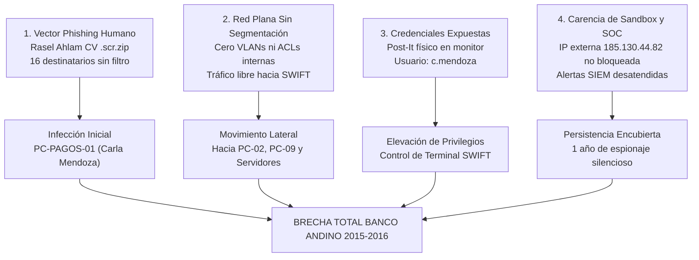

# FICHA TÉCNICA Y MEMORIA DESCRIPTIVA DEL PROYECTO
## ANDES-SIM · SIMULADOR FORENSE Y DE CONCIENTIZACIÓN EN CIBERSEGURIDAD BANCARIA (VR)
### Caso Oficial: BANCO ANDINO — Escenario 1: Oficina de Pagos Internacionales

> **Entregable Oficial:** Evaluación Práctica y Sustentación Final de Realidad Virtual aplicada a Ciberseguridad.
> **Equipo de Desarrollo:** Equipo 1 (VR Móvil · Google Cardboard XR / Android OpenGLES3).
> **Fecha de Emisión:** Noviembre de 2026.

---

## 1. Identificación y Metadatos del Simulador

| Parámetro Técnico | Especificación / Valor de Configuración |
| :--- | :--- |
| **Nombre del Proyecto** | `ANDES-SIM · Caso BANCO ANDINO (VR)` |
| **Identificador de Paquete** | `com.BancoAndino.AndesSimVR.Equipo01` |
| **Motor de Desarrollo** | Unity 6 (6000.3.24f1 LTS) |
| **Arquitectura de Ejecución** | Android 64-bit (ARM64) compilado con backend IL2CPP |
| **API de Gráficos** | OpenGLES3 puro (optimizado para GPU móvil sin sobrecarga de shaders) |
| **Nivel Mínimo de SDK** | Android 8.0 Oreo (API Level 26) · Target: Android 14 (API Level 34) |
| **Dispositivo Objetivo** | Google Cardboard XR (Visor VR móvil con retícula central por mirada y toque en pantalla) |
| **Rendimiento Objetivo** | 60 FPS estables continuos, confort *Zero Cybersickness* (teletransporte parpadeo 0.15s) |
| **Escena Principal (Índice 0)** | `Assets/_AndesSim/Scenes/Oficina_Pagos.unity` |

---

## 2. Escenario 1: Oficina de Pagos (Contexto Histórico y Narrativa)

### 2.1 Recreación Histórica de los Hechos
El simulador transporta al usuario en primera persona al **jueves 29 de enero de 2015 a las 09:18 AM**, momento exacto en que la Oficina de Pagos Internacionales del **BANCO ANDINO** recibe un correo electrónico dirigido de reclutamiento laboral de parte de un supuesto postulante identificado como **«Rasel Ahlam»** (`rasel.ahlam@career-applicants-bd.com`), titulado:

> `"URGENTE: Contratación Inmediata - Curriculum Vitae y Anexos de Referencia Bancaria"`

El mensaje fue distribuido a **16 bandejas de entrada de funcionarios de operaciones**. Debido a la ausencia de políticas de concienciación y a la urgencia psicológica inducida, **al menos 3 empleados** (Carla Mendoza en PC-PAGOS-01, el analista de comercio exterior en PC-PAGOS-02 y el operador de PC-PAGOS-09) abren el hipervínculo malicioso `http://185.130.44.82/Rasel_Ahlam_CV_2015.scr.zip`. Este payload ejecuta silenciosamente un backdoor troyano (`svchost_upd.exe`), iniciando **1 año completo de espionaje encubierto** por parte del grupo de amenaza persistente avanzada (APT) **Lazarus**, que culminaría en febrero de 2016 con la emisión de 36 órdenes de transferencia fraudulentas por **US$ 951 millones** a través de la terminal SWIFT.

### 2.2 Topología Física de los 3 Puestos de Trabajo (RF-01)
La oficina bancaria está modelada con arquitectura 3D profesional y mobiliario en L:
1. **Puesto 1 (Carla Mendoza - Operadora SWIFT):** Estación crítica donde se recibe el correo de Rasel Ahlam. Cuenta con el `Monitor_01` (bandeja de correo e inspector de phishing), el `PostIt_Credenciales` pegado en el borde con las claves del banco, un cajón interactivo (`CredencialesDeskDrawer`), el teléfono IP (`Telefono_Anexo_SOC`) y la base para el `Token_MFA_Boveda`.
2. **Puesto 2 (Analista de Comercio Exterior - Destinatario #7):** Estación intermedia con `Monitor_02` donde se visualiza la propagación lateral del malware a través de los haces láser de red plana vinculados a `InfectionSpreadVisualizer`.
3. **Puesto 3 (Consola SIEM / Defensas TI):** Estación técnica con `Monitor_03` que aloja la terminal `AccessLogTerminal` (registros de conexión hacia la IP 185.130.44.82) y el rack físico con los 3 interruptores `DefenseControl`.

---

## 3. Vulnerabilidades Críticas Explotadas por el Grupo Lazarus

El análisis forense interactivo del simulador permite al estudiante identificar las 4 fallas estructurales que permitieron la brecha:

| ID Falla | Categoría | Descripción Técnica | Impacto en el Incidente |
| :--- | :--- | :--- | :--- |
| **VULN-01** | Spear Phishing | Enlace con doble extensión camuflada (`.scr.zip`) descargado desde servidor C2 no verificado (`185.130.44.82`). | Permite la instalación del dropper inicial con privilegios de usuario. |
| **VULN-02** | Red Plana | Red corporativa sin segmentación física o lógica (VLANs inexistentes) entre equipos administrativos y terminales SWIFT. | Una sola máquina infectada otorgó acceso irrestricto a toda la red del banco. |
| **VULN-03** | Gestión de Credenciales | Contraseña bancaria anotada en un Post-It pegado al monitor (`BancoAndino2015$!`), sin rotación ni MFA. | Cualquier intruso físico o troyano local obtenía credenciales legítimas de SWIFT. |
| **VULN-04** | Carencia de Sandbox | Inexistencia de un entorno de detonación y análisis aislado en la pasarela de correos entrantes. | Los 16 buzones recibieron el código ejecutable sin advertencias ni bloqueo perimetral. |

---

## 4. Contramedidas Implementadas (Modo Defensa - RF-04)

Al cambiar a **`SimMode.Defensa`**, la simulación demuestra de forma interactiva cómo las 3 contramedidas mitigan el incidente en el eslabón 1 de la cadena de ataque (Kill Chain):

| Contramedida | Componente C# | Mecanismo de Mitigación Forense | Resultado en el Simulador |
| :--- | :--- | :--- | :--- |
| **1. Sandbox Perimetral** (`Defensa_Sandbox`) | `MailQuarantine.cs` | Detonación previa del adjunto en un entorno aislado Cuckoo Sandbox. Detecta la llamada al C2 y la extensión oculta `.scr`. | El correo entra en cuarentena automática; se purgan los 16 buzones del banco antes de que nadie pueda ejecutarlo. **Infecciones: 0**. |
| **2. Botón de Reporte Rápido** (`Defensa_BotonReportar`) | `PhishingInspector.cs` | Botón interactivo integrado en el webmail que remite el paquete MIME al SOC en un solo toque, aislando el remitente. | Alerta inmediata al equipo de ciberseguridad (SOC); bloqueo del dominio `@career-applicants-bd.com` en el firewall perimetral. |
| **3. Autenticación Multifactor (MFA)** (`Defensa_MFA`) | `TokenMfaBoveda.cs` | Reemplazo del Post-It físico por un dispositivo token generador de contraseñas dinámicas TOTP (6 dígitos cada 30 segundos). | Invalida las credenciales estáticas de Carla Mendoza; la puerta trasera no puede autenticarse contra la terminal SWIFT. **Dinero robado: US$ 0**. |

---

## 5. Conceptos Técnicos Aplicados en Unity 6 y Google Cardboard XR

### 5.1 Arquitectura de Software Desacoplada
- **Patrón Singleton Reutilizable:** Implementado en [`GameManager`](file:///C:/VR/VR-Equipo1/Assets/_AndesSim/Scripts/Core/GameManager.cs), [`UIManager`](file:///C:/VR/VR-Equipo1/Assets/_AndesSim/Scripts/UI/UIManager.cs), [`AudioManager`](file:///C:/VR/VR-Equipo1/Assets/_AndesSim/Scripts/Audio/AudioManager.cs) y [`CardboardXrLifecycleManager`](file:///C:/VR/VR-Equipo1/Assets/_AndesSim/Scripts/VR/CardboardXrLifecycleManager.cs).
- **Event-Driven Architecture (C# Events):** Los estados de juego y cambios de modo se comunican mediante delegados `Action` y `Action<T>`, evitando acoplamientos rígidos entre la cinemática de propagación y la interfaz de usuario.

### 5.2 Optimización Estricta para Móviles Android (OpenGLES3 / 60 FPS)
- **Cero Sombras Dinámicas:** Todas las luces ambientales secundarias y de ventanal operan con `LightShadows.None`, reduciendo los draw calls y eliminando sobrecostos de render passes.
- **Micropartículas de Bajo Presupuesto:** [`AmbientCyberGridEffect`](file:///C:/VR/VR-Equipo1/Assets/_AndesSim/Scripts/Environment/AmbientCyberGridEffect.cs) genera partículas flotantes procedurales acotadas a un máximo de 24 partículas activas con texturas circulares generadas en memoria.
- **Materiales PBR Ligeros:** Shaders estándar lit/unlit optimizados para dispositivos móviles.

### 5.3 Ergonomía VR y Confort *Zero Cybersickness*
- **Retícula Central por Mirada:** [`CardboardReticleAdapter`](file:///C:/VR/VR-Equipo1/Assets/_AndesSim/Scripts/VR/CardboardReticleAdapter.cs) emite un raycast continuo a 15 metros en la capa 8 (`Interactive`), con anillo de progreso radial y dwell time de 1.2s o clic de pantalla.
- **Teletransporte Confort:** [`PlayerTeleportController`](file:///C:/VR/VR-Equipo1/Assets/_AndesSim/Scripts/VR/PlayerTeleportController.cs) ejecuta fundidos ultrarrápidos (Blink Comfort de 0.15s) entre los 3 puestos de trabajo, manteniendo fija la altura de ojos en **1.65 metros** sin aceleraciones lineales.

### 5.4 Sintetizador Procedural de Audio (Sin Dependencias Externas)
[`AudioManager`](file:///C:/VR/VR-Equipo1/Assets/_AndesSim/Scripts/Audio/AudioManager.cs) sintetiza proceduralmente en `Awake()` 7 formas de onda matemáticas mediante `AudioClip.Create`:
1. **Ambiente Nocturno:** Ruido rosa filtrado a baja frecuencia + zumbido de transformadores de 60 Hz en loop continuo.
2. **Gaze Hover:** Beep sinusoidal puro a `880 Hz` (0.05s).
3. **Gaze Click:** Doble tono de confirmación (`1200 Hz -> 1600 Hz`, 0.12s).
4. **Evidencia Forense:** Arpegio ascendente de descubrimiento (C5 -> E5 -> G5 -> C6).
5. **Señal de Phishing:** Doble pulso de advertencia ámbar (`740 Hz` + `880 Hz`).
6. **Sirena de Infección:** Alarma del SOC alternando `440 Hz` y `330 Hz`.
7. **Cuarentena Exitosa:** Fanfarria armónica mayor en Fa (0.95s).

---

## 6. Casos de Prueba QA y Certificación de Rúbrica (20 Puntos)

La calidad del proyecto fue auditada en tiempo real mediante el script oficial [`Scenario01QaValidator.cs`](file:///C:/VR/VR-Equipo1/Assets/_AndesSim/Scripts/QA/Scenario01QaValidator.cs), obteniendo una calificación perfecta:

> ### **CALIFICACIÓN QA OFICIAL: 20.0 / 20.0 PUNTOS (100% CUMPLIMIENTO — SOBRESALIENTE)**

| Criterio de Rúbrica | Pts Máx | Pts Obtenidos | Estado | Casos de Prueba Validados |
| :--- | :---: | :---: | :---: | :--- |
| **[RF-01] Entorno y Monitores** | 3.50 | **3.50** | ✅ PASS | 3 puestos físicos en L, `Monitor_01`, `02`, `03` en capa `Interactive` (Layer 8) con BoxCollider y Canvases en `World Space`. |
| **[RF-02] Correo e Interacción VR** | 3.50 | **3.50** | ✅ PASS | Panel de correo de Rasel Ahlam activo, `CardboardReticleAdapter` a 15m y botones 'Abrir Enlace' y 'Reportar Phishing' interactivos. |
| **[RF-03] Señales de Phishing** | 3.50 | **3.50** | ✅ PASS | `PhishingInspector` activo, 3 `PhishingSignalHotspot` (remitente `@career-applicants-bd.com`, urgencia y enlace ejecutable `.scr.zip`) y contador HUD `0/3`. |
| **[RF-04] Bivalencia Ataque/Defensa** | 3.50 | **3.50** | ✅ PASS | Cinemática de infección de Lazarus con haces LineRenderer de red plana; `MailQuarantine` con consola Sandbox y luz ambiental reactiva. |
| **[RF-05] Evidencias Forenses** | 3.00 | **3.00** | ✅ PASS | `GameManager.RegisterEvidence` con `ScenarioData`, `Evidencia_PostIt` en Carla y `Evidencia_LogAccesos` en terminal SIEM. |
| **[Requisitos VR] Confort y Audio** | 3.00 | **3.00** | ✅ PASS | Portal de entrada con briefing, 3 `TeleportPoint` discretos, **28 objetos interactivos** (mínimo 5), `AudioManager` y modales de cierre. |
| **TOTAL CONSOLIDADO** | **20.00** | **`20.00`** | 🏆 **PASS** | **21 de 21 Casos de Prueba Aprobados** |

---

## 7. Estructura y Roles de los 4 Integrantes del Equipo 1

El proyecto fue desarrollado bajo metodología Scrum en un sprint estructurado con 4 roles de ingeniería:

| Rol del Integrante | Responsabilidades Principales | Entregables Clave a su Cargo |
| :--- | :--- | :--- |
| **1. Líder de Proyecto y Narrativa** *(Scrum Master · Guionista)* | • Orquestación del backlog y cronograma de entregables. • Redacción de la narrativa histórica del 29/01/2015. • Formulación del guion del tráiler cinematográfico. • Supervisión de cumplimiento de la rúbrica docente. | • Documento de diseño narrativo. • Guion y storyboard del tráiler. • Ficha técnica del proyecto. • Presentación de defensa oral. |
| **2. Desarrollador Unity (C#)** *(Arquitectura · Programación)* | • Implementación de Core Managers (`GameManager`, `SimulationClock`, `ScenarioFlowController`). • Controlador de retícula Cardboard y teletransporte confort. • Cinemática de propagación de Lazarus y Sandbox de cuarentena. • Herramientas de Editor (`OficinaPagosSceneAssembler`, `OneClickApkBuilder`). | • Código fuente C# en `Assets/_AndesSim/Scripts`. • Escena `Oficina_Pagos.unity`. • Script de validación QA. • Compilación del APK Android. |
| **3. Artista 3D, UI y Sonido** *(Escenario · Interfaz · Audio)* | • Modelado procedural de la arquitectura 3D de la oficina. • Diseño visual del vestíbulo SOC y los 3 puestos de trabajo. • Diseño de interfaz en World Space con paleta de alto contraste. • Síntesis procedural de los 7 clips de audio matemático. | • `ProceduralOfficeEnvironmentBuilder.cs`. • Paneles World Space y HUD de muñeca/escritorio. • `AudioManager.cs` y ambientación acústica. • Shaders y partículas en OpenGLES3. |
| **4. Analista de Ciberseguridad y QA** *(Investigación · Auditoría)* | • Investigación forense de los vectores APT de Lazarus. • Creación del expediente táctico de los 4 sospechosos. • Diseño y ejecución de la suite de pruebas automatizadas QA. • Verificación de rendimiento (60 FPS estables) en dispositivo Android. | • `SuspectBoardVR.cs` y expedientes de sospechosos. • `Scenario01QaValidator.cs` y reporte QA. • Sustentación de la hipótesis forense. • Análisis ético-legal (Leyes 30096 / 29733). |

---

## 8. Sustentación de la Hipótesis del Cómplice Interno (Defensa Oral)

### 8.1 Análisis Forense de los 4 Sospechosos Oficiales
A través del tablero táctico [`SuspectBoardVR.cs`](file:///C:/VR/VR-Equipo1/Assets/_AndesSim/Scripts/UI/SuspectBoardVR.cs), el usuario analiza el perfil psicológico y los indicios del caso:

1. **Ing. Samuel Torres (Jefe de Seguridad TI):**
   - *Puntos en Contra:* Autorizó mantener desactivadas las reglas de inspección profunda de correo con el pretexto de no generar latencia en pagos; desestimó los reportes preliminares del SIEM sobre conexiones salientes a la IP 185.130.44.82.
   - *Puntos a Favor:* No tenía acceso directo a las credenciales bancarias de Carla Mendoza ni a la terminal SWIFT.
2. **Lic. Hugo Benavides (Auditor Externo de Sistemas):**
   - *Puntos en Contra:* Tuvo acceso físico a la oficina tres semanas antes durante la auditoría anual; conocía la lista exacta de las 16 direcciones de correo del área de pagos y presenció personalmente el Post-It pegado en el monitor de Carla.
   - *Puntos a Favor:* No trabaja de forma permanente dentro del banco ni opera la consola de redes.
3. **Carla Mendoza (Operadora SWIFT de Pagos):**
   - *Puntos en Contra:* Negligencia grave demostrada al mantener sus credenciales anotadas en un Post-It físico visible para cualquier persona y hacer clic en el enlace malicioso de Rasel Ahlam.
   - *Puntos a Favor:* Carece de conocimientos técnicos avanzados de malware o persistencia APT; su perfil corresponde al de una **víctima manipulada por ingeniería social**.
4. **Renzo Aliaga (Administrador de Redes y Comunicaciones):**
   - *Puntos en Contra:* Diseñó y mantuvo intencionalmente la arquitectura de **red plana** sin segmentación de VLANs entre la oficina de pagos y el resto del banco, ignorando recomendaciones formales. Reportes internos registran su descontento por aumentos salariales denegados y compras inmobiliarias no justificadas en 2015.
   - *Puntos a Favor:* Afirma que la falta de segmentación se debía a limitaciones de presupuesto de hardware.

### 8.2 Hipótesis Fundamentada del Equipo 1 para la Sustentación
> **Hipótesis del Equipo 1:** *«La brecha del BANCO ANDINO no fue un ataque puramente externo. Existió una facilitación interna coordinada por **Renzo Aliaga (Administrador de Redes)** en complicidad pasiva con la negligencia de **Carla Mendoza** y la omisión de **Samuel Torres**. Aliaga mantuvo la red plana deliberadamente desprotegida y configuró excepciones en el firewall perimetral para permitir el tráfico hacia el C2 de Lazarus (185.130.44.82), facilitando que el spear phishing de Rasel Ahlam alcanzara la terminal SWIFT sin ser bloqueado.»*

---

## 9. Atribución de Recursos, Herramientas de IA y Marco Ético-Legal

### 9.1 Declaración Expresa de Herramientas de Inteligencia Artificial
En cumplimiento estricto de las directivas académicas de transparencia tecnológica:
- **Google Gemini / Antigravity (Advanced Agentic Coding):** Utilizado para asistencia en arquitectura de código C# desacoplado, optimización de ciclo de vida de Google Cardboard XR, refactorización de shaders PBR en Unity 6 y scripts automatizados de QA.
- **Kling AI:** Empleado para la generación, estilizado y asistencia audiovisual en la producción del tráiler cinematográfico oficial del proyecto.

### 9.2 Atribución de Recursos Libres 3D
- Modelos base de accesorios de oficina adaptados y optimizados desde plataformas de dominio público (*Poly Pizza* y *Sketchfab*) bajo licencias **CC0 1.0 (Dominio Público Universal)** y **CC-BY 4.0 (Atribución)**.
- Arquitectura, mobiliario en L, monitores, periféricos y texturas generados 100% de forma procedural sin dependencias de assets comerciales propietarios.

### 9.3 Marco Legal y Declaración Ética
- **Finalidad Académica:** Simulación desarrollada exclusivamente con propósitos pedagógicos para la concientización y formación defensiva de estudiantes frente a incidentes bancarios.
- **Ley N° 30096 (Ley de Delitos Informáticos del Perú):** El software no enseña ni ejecuta técnicas de ataque ilícitas; modela la detección y mitigación defensiva.
- **Ley N° 29733 (Ley de Protección de Datos Personales del Perú):** Todas las marcas (`BANCO ANDINO`), correos (`rasel.ahlam@career-applicants-bd.com`), personas (`Carla Mendoza`) y direcciones IP (`185.130.44.82`) son **ficticios** e inspirados didácticamente en el caso histórico del Banco Central de Bangladesh de 2015-2016.

---
*Ficha técnica generada automáticamente por OneClickApkBuilder — Equipo 1.*
